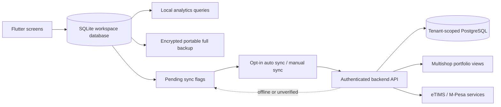
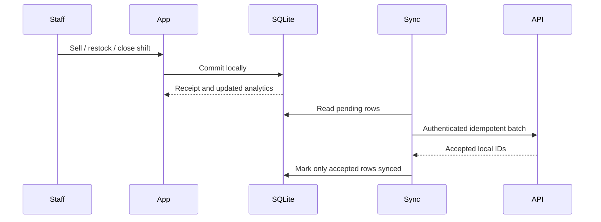

# SimpleSales data architecture

SimpleSales is offline-first: the local SQLite database is the source of truth
for selling, stock, shifts, receipts, audit history, and analytics source
records. Network services are resumable projections, never prerequisites for a
sale.

## Ownership and movement

| Data | Local owner | Online projection | Offline behavior |
| --- | --- | --- | --- |
| Products and stock | SQLite product tables | Tenant product API | Sell and restock locally; retry pending writes |
| Sales and sale items | SQLite sales tables | Tenant sales API, idempotent by local sale id | Complete sale, receipt, and analytics locally |
| Staff and roles | SQLite staff tables | Tenant staff API | Local staff/PIN access continues; sync resumes later |
| Shifts, returns, deliveries, shot cups | SQLite operational tables | Domain sync endpoints | Queue remains on-device until accepted |
| Audit and analytics source data | SQLite audit/sales/stock tables | Derived online reports where enabled | Local analytics and exports remain available |
| All user/shop data | Full SQLite snapshot | Portable encrypted backup or later cloud backup | Restore to a new device from the passphrase backup |

Every online write is authenticated and tenant-scoped by the backend. The
client marks a record synced only after an acknowledgement; retries therefore
remain safe across outages and process restarts.

