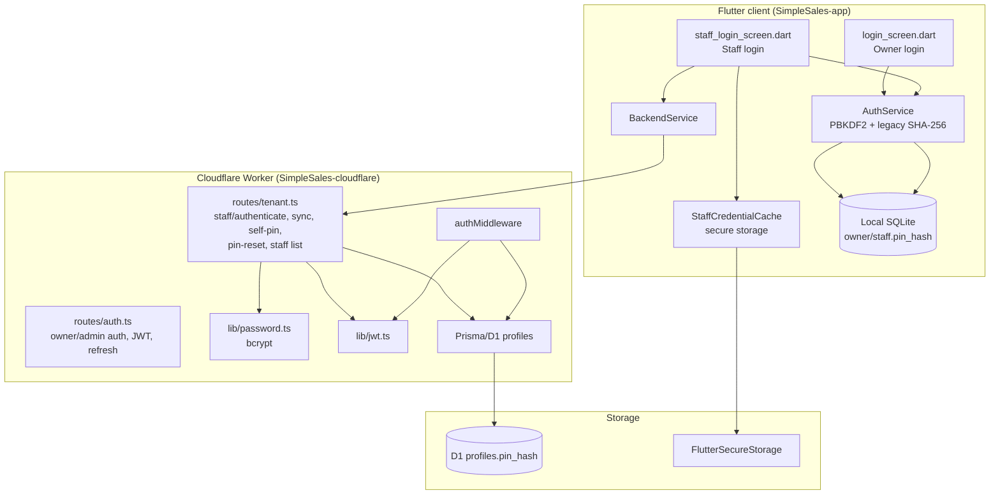

# SimpleSales — Authentication V2 Audit

**Scope:** Comprehensive read-only audit of all authentication implementations across the SimpleSales POS stack.
**Repositories examined:**
- `SimpleSales-cloudflare` (branch `cloudflare`) — backend Cloudflare Worker (`duka_pos_backend/`), Prisma/D1, and Flutter app shell.
- `SimpleSales-app` (branch `app`) — Flutter client (`duka_pos_app/`).
- `SimpleSales-admin` (branch `admin`) — Next.js admin console (`duka_pos_admin/`).

**Authority:** Cloudflare Worker. **Target standard:** PBKDF2-HMAC-SHA256, 6-digit numeric PIN, unified online/offline staff authentication.

**Phase:** Audit only. No application code, configuration, database, or credentials were modified.

---

## A. Executive summary

The authentication architecture is **fragmented and duplicated**, with multiple credential domains and at least two distinct PIN implementations that disagree on PIN length, iteration counts, and encoding. Staff authentication is split between an **online** path (`/tenant/staff/authenticate`, authority Cloudflare Worker) and an **offline** path (local SQLite `staff.pin_hash` verified by the Flutter `AuthService`), bridged by a sync layer that uploads PBKDF2 hashes but never downloads them. The two paths can authorize different outcomes for the same account: the client explicitly keeps a locally verified session even when the backend rejects the PIN.

Key facts:

- Staff PINs use PBKDF2-HMAC-SHA256 on both sides, but with **different iteration defaults** (backend `120_000`, client `120000` — numerically equal but the client also permits legacy single-round SHA-256 and auto-upgrades).
- PIN length policy is **inconsistent**: backend `staffAuthenticateSchema` allows 4–8 digits, `staffSelfPinSchema` requires exactly 4, `staffPinResetApproveSchema` requires exactly 4, `password.ts#isSixDigitPassword` requires 6, and the client documents a 4-digit keyspace. The stated V2 policy is exactly 6 digits.
- Owner/admin credentials use **bcrypt** (10 rounds) and **SHA-256** (admin keys), a separate domain from staff PINs.
- Staff session tokens are JWTs (HS256, 30-day TTL) with **no server-side revocation**; role is hardcoded to `cashier` for the self-pin token.
- Synchronization uses `COALESCE(?, pin_hash)` so a null incoming hash never overwrites server state, but a non-null PBKDF2 hash from any device replaces/sets server state without version checks.
- Local authentication can survive a backend rejection (`remotePinMismatch` keeps the session), which weakens the online authority.
- `AuthService.verifyPin` accepts legacy SHA-256 hashes and silently upgrades them; the backend has no legacy path (returns false for non-`pbkdf2$` hashes).

Classification: **Fragmented, partially centralized, inconsistent policy, with security-relevant divergence between online and offline authorization.**

---

## B. Authentication architecture map

Flows:
1. **Owner login (client):** `login_screen.dart:229` → `AuthService.verifyPin(pin, owner.pinHash)` against local SQLite; on legacy hash, re-hashes and `updateOwnerPin`.
2. **Staff login (client):** `staff_login_screen.dart:360+` → local verify first; if verified and tenant known, calls `BackendService.authenticateStaff` (online). On backend rejection due to PIN mismatch, keeps local session. If no local match, requires online auth and merges via `mergeAuthenticatedStaff`.
3. **Online staff auth (backend):** `POST /tenant/staff/authenticate` (`tenant.ts:1612`) → D1 `profiles` lookup by tenant+username+role+active → `verifyStaffPin` (PBKDF2 only) → issues staff session JWT.
4. **Staff sync up:** `POST /tenant/staff/sync` (`tenant.ts:1412`) → upsert profiles, `pin_hash = COALESCE(?, pin_hash)`.
5. **Staff pull:** `GET /tenant/staff` (`tenant.ts:1526`) → returns metadata only, no PIN material.
6. **PIN change:** `POST /tenant/staff/self-pin` (`tenant.ts:1792`) → verifies current PIN via `verifyStaffPin`, writes `hashStaffPin(newPin)`.
7. **PIN reset:** request/approve flow (`tenant.ts:1825+`) with 4-digit temporary PIN.
8. **Owner/admin auth (backend):** `routes/auth.ts` + `routes/admin_auth.ts` — email/password + verification codes, bcrypt, admin keys (SHA-256), JWT access/refresh tokens.

---

## C. Implementation inventory

### Backend (SimpleSales-cloudflare/duka_pos_backend)

| File | Symbol | Role |
|---|---|---|
| `src/routes/tenant.ts:47` | `STAFF_PIN_HASH_ITERATIONS = 120_000` | Staff PIN work factor |
| `src/routes/tenant.ts:49` | `deriveStaffPin()` | PBKDF2-HMAC-SHA256 via Web Crypto |
| `src/routes/tenant.ts:65` | `decodeBase64Url()` | base64url → bytes (padding tolerant) |
| `src/routes/tenant.ts:75` | `encodeBase64Url()` | bytes → base64url (unpadded) |
| `src/routes/tenant.ts:82` | `verifyStaffPin()` | PBKDF2 verify only; no legacy |
| `src/routes/tenant.ts:107` | `hashStaffPin()` | PBKDF2 hash creator |
| `src/routes/tenant.ts:1612` | `POST /staff/authenticate` | Online staff auth |
| `src/routes/tenant.ts:1412` | `POST /staff/sync` | Upsert staff + COALESCE pin |
| `src/routes/tenant.ts:1526` | `GET /staff` | Pull metadata (no PIN) |
| `src/routes/tenant.ts:1792` | `POST /staff/self-pin` | PIN change |
| `src/routes/tenant.ts:1825` | `POST /staff/pin-reset-request` | Reset request |
| `src/routes/tenant.ts:1860` | `GET /staff/pin-reset-requests` | List resets |
| `src/routes/tenant.ts:1885` | `POST /staff/pin-reset-requests/:id/reset` | Approve with temp PIN |
| `src/lib/password.ts` | `hashPassword/verifyPassword/isSixDigitPassword` | bcrypt (owner/admin passwords) |
| `src/lib/jwt.ts` | `issueStaffSessionToken/verifyStaffSessionToken` | Staff session JWT |
| `src/lib/jwt.ts` | `issueAccessToken/verifyAccessToken` | Owner/admin JWT |
| `src/middleware/auth.ts` | `authMiddleware` | Bearer + tenant + entitlement |
| `src/lib/validation.ts:232` | `staffSyncSchema` | pinHash string ≤400 |
| `src/lib/validation.ts:664` | `staffAuthenticateSchema` | pin 4–8 digits |
| `src/lib/validation.ts:669` | `staffSelfPinSchema` | 4 digits |
| `src/lib/validation.ts:678` | `staffPinResetApproveSchema` | 4 digits |
| `prisma/schema.prisma:539` | `Profile` | pinHash, username, role, active, tenant |
| `src/routes/admin_auth.ts` | admin login | bcrypt? SHA-256 admin keys |

### Client (SimpleSales-app)

| File | Symbol | Role |
|---|---|---|
| `lib/services/auth_service.dart` | `AuthService.hashPin/verifyPin` | PBKDF2 + legacy SHA-256 |
| `lib/services/auth_service.dart:69` | `defaultIterations = 120000` | Client work factor |
| `lib/services/auth_service.dart:184` | legacy SHA-256 path | `_legacyHash` |
| `lib/services/staff_credential_cache.dart` | cache of PBKDF2 hash in secure storage | Offline fallback |
| `lib/screens/staff_login_screen.dart` | `_submit` | Hybrid online/offline flow |
| `lib/screens/login_screen.dart` | owner login | AuthService against local DB |
| `lib/db/database_helper.dart` | `staff`/`owner` tables | local pin_hash storage |
| `lib/services/backend_service.dart:4303` | `syncStaffToBackend` | uploads pinHash if pbkdf2$ |
| `lib/services/backend_service.dart:4330` | `pullStaffFromBackend` | metadata only |
| `lib/services/pin_reset_service.dart` | temp PIN handling | AuthService.hashPin |

---

## D. Duplication and inconsistency report

| # | Implementation | Classification | Impact |
|---|---|---|---|
| 1 | `AuthService.verifyPin` accepts legacy single-round SHA-256 (`auth_service.dart:111-139`); backend `verifyStaffPin` does not | DUPLICATE / INCONSISTENT | A legacy hash that the client accepts will be rejected online; auto-upgrade only happens after a successful local verify, so a device with only a legacy hash and no connectivity cannot be "fixed" by the server. |
| 2 | PIN length: client 4-digit docs, backend 4–8, self-pin 4, reset 4, `isSixDigitPassword` 6 | INCONSISTENT | Violates target 6-digit policy; allows weak 4-digit PINs and rejects legitimate 6-digit changes via self-pin regex. |
| 3 | Staff auth online vs offline can disagree | INCONSISTENT | `staff_login_screen.dart:433-436`: on backend PIN mismatch, client keeps locally verified session, so a stale local hash authorizes access despite server rejection. |
| 4 | `staffSelfPinSchema` `/^\d{4}$/` vs target 6 | INCONSISTENT | PIN change endpoint cannot accept 6-digit PINs. |
| 5 | Iteration cap: client `maxStoredIterations = 2,000,000`; backend `iterations > 2,000,000` rejected | CONSISTENT | OK, but both must stay aligned. |
| 6 | Salt encoding: Dart `base64UrlEncode` (padded) vs backend `encodeBase64Url` (unpadded) | INCONSISTENT (handled) | Fixed in commit 27b9fb29 by padding-tolerant decode; client decode uses Dart `base64Url.decode` which accepts padding. Risk remains if new encoders are introduced. |
| 7 | `StaffCredentialCache.cacheStaffCredentials` stores an unused `salt` field alongside the hash | DUPLICATE / DEAD DATA | Salt is already embedded in the self-describing hash; redundant storage increases confusion. |
| 8 | `mergeRemoteStaff` writes `pin_hash = ''` (empty string) for pulled staff | INCONSISTENT | Empty string is not null; `AuthService.verifyPin('', '')`? verifyPin('','') → legacy path compares SHA-256(''...') to '' → false. But empty pin_hash in DB violates NOT NULL? Local allows empty string. Risk of confusion with "no hash". |
| 9 | Owner PIN and staff PIN both use the same `AuthService` but owner uses local DB only; no online owner PIN verification | FRAGMENTED | Owner credentials never verified by Cloudflare Worker; authority is device-local. |
| 10 | Admin keys use SHA-256 of the key (single round) | INCONSISTENT (separate domain) | Not PBKDF2; acceptable for high-entropy keys but should be documented as a distinct domain. |

---

## E. Cryptographic compatibility report

| Property | Backend (`verifyStaffPin`/`hashStaffPin`) | Client (`AuthService`) |
|---|---|---|
| Algorithm | PBKDF2 | PBKDF2 (+ legacy SHA-256) |
| Digest | SHA-256 | SHA-256 (Hmac.sha256) |
| Iterations | 120,000 (fixed) | 120,000 default; reads from stored hash |
| Salt | 16 bytes, `crypto.getRandomValues` | 16 bytes, `Random.secure()` |
| Derived key | 32 bytes (256 bits) | 256 bits |
| Encoding | base64url unpadded (backend) / accepts padded | Dart `base64UrlEncode` (padded per commit note) |
| Stored format | `pbkdf2$<iter>$<salt>$<key>` | `pbkdf2$<iter>$<salt>$<key>` |
| Comparison | constant-time XOR loop | `_constantTimeEquals` XOR loop |
| Input handling | no trim/normalization of PIN in verifier (receives as-is) | `password.trim()` at call sites; `utf8.encode(pin)` |
| Runtime | Web Crypto (`globalThis.crypto.subtle`) | `package:cryptography` Pbkdf2 |
| Legacy | none (returns false) | single-round SHA-256 `sha256(salt:pin)` |

Differences requiring unification:
- Client trims PIN input; backend `staffAuthenticateSchema` trims username but `pin` is trimmed by zod (`z.string().trim()`), so both trim. However client `AuthService.hashPin` does not trim internally — relies on callers. Inconsistent if a caller forgets to trim.
- Client accepts legacy SHA-256; backend does not. For V2 (unified authority on Worker), the client should not accept legacy hashes for staff; legacy upgrade should be a server-driven migration or removed.
- Base64 padding: backend now padding-tolerant; client decode tolerant. Keep this defensive handling in V2.
- Iteration count must be a single constant shared by both sides (or server-authoritative).

---

## F. Production and local environment report

- Wrangler (`wrangler.jsonc`): production D1 `duka-pos-prod` (id `97bc…`), staging `duka-pos-staging` (id `5fcb…`). Separate R2 buckets per env. Bindings declared per env (not inherited).
- Secrets: `AUTH_JWT_SECRET`, `EMAIL_VERIFICATION_SECRET`, `SYSTEM_ADMIN_TOKEN`, `STAGING_AUTH_TEST_SECRET` are secrets (not in vars). `SYSTEM_ADMIN_EMAIL` is a var (`brian@nerva.co.ke`). `VERIFICATION_DEBUG_CODES=true` only in staging.
- Prisma adapter: Prisma client generated; D1 is the runtime DB. Migrations in `prisma/migrations-d1/` (Wrangler-applied), not `prisma migrate deploy`.
- Dev vs prod auth differences:
  - Debug verification codes only in staging (`debugCodesEnabled` requires staging URL + secret).
  - `AUTH_TEST_CODE` only honored when `NODE_ENV === 'test'`.
  - Rate limiters fall back to no-op in non-Node (Worker) runtime (`_isNode` check), so production Worker has **no rate limiting** on staff auth. This is a security gap.
  - `process.env` in Worker runtime comes from Wrangler vars/secrets; Express dev path uses Node env.
- Client: single codebase; workspace key scopes lockout and credential cache. No env-specific crypto differences.

---

## G. Security findings

| ID | Severity | Finding | Evidence | Impact | Remediation |
|---|---|---|---|---|---|
| G-1 | Critical | Rate limiters are disabled in the Worker runtime | `auth.ts`/`tenant.ts`: `const _isNode = typeof module !== 'undefined'`; limiters become no-op in Workers | Brute-force online staff PINs and admin logins unprotected in production | Implement Worker-native rate limiting (Durable Object or KV counters) or use Cloudflare rate-limiting rules |
| G-2 | Critical | Offline authorization can override online rejection | `staff_login_screen.dart:433-436` keeps session on remote PIN mismatch | A device with a stale local hash authorizes access even after server-side PIN change/reset | Make online rejection authoritative for online-capable devices; clear local credential on authoritative rejection |
| G-3 | High | PIN policy not enforced (4–8 digits accepted online) | `validation.ts:666` `pin: min(4).max(8)`; self-pin 4 digits | Weak PINs; target is exactly 6 | Enforce `/^\d{6}$/` everywhere (client + backend + reset) |
| G-4 | High | Staff session JWT has 30-day TTL and no revocation | `jwt.ts:30` `STAFF_SESSION_TTL_SECONDS = 30 days`; no jti store | Revoked devices/sessions remain usable for up to 30 days | Add server-side session revocation or shorten TTL with refresh |
| G-5 | High | Staff session token role hardcoded to `cashier` | `middleware/auth.ts:104` `role: 'cashier'` | A manager using a staff session cannot access manager operations; conversely role not verified against DB | Load profile/role from DB by profileId in middleware |
| G-6 | Medium | Legacy SHA-256 accepted client-side only | `auth_service.dart:137-139` | Inconsistent verification; potential downgrade if a hash is replaced | Remove legacy path in V2 or make server-driven |
| G-7 | Medium | Empty-string pin_hash for pulled staff | `database_helper.dart:4455` `'pin_hash': ''` | Ambiguous "no credential" state; `verifyPin` returns false but empty is not null | Use null/absent and handle explicitly; for V2 require server-issued verifier |
| G-8 | Medium | Sync can overwrite server hash without versioning | `tenant.ts:1487` `COALESCE(?, pin_hash)` accepts any pbkdf2$ hash | An older device can push a stale hash that becomes authoritative | Add credential version/timestamp and last-write-wins with version check |
| G-9 | Medium | Tenant ID can be supplied by client header | `tenant.ts:1646` `tenantId = authTenantId ?? headerTenantId` | For unauthenticated staff bootstrap, client-controlled tenant; mitigated by username+PIN verify, but tenant existence not validated beyond DB query | Validate tenant existence and active state; prefer server-derived tenant from a trusted device token |
| G-10 | Low | Salt stored redundantly in secure storage | `staff_credential_cache.dart:91-95` | Minor confusion; not a secret leak (salt is public) | Remove redundant salt field |
| G-11 | Low | `AuthService` documents 4-digit keyspace | Comment at `auth_service.dart:44` | Misleading; underestimates policy | Update to 6 digits |
| G-12 | Info | Admin keys hashed with single SHA-256 | `admin_auth.ts:97` | Acceptable for high-entropy keys but inconsistent with PBKDF2 standard | Document as separate domain; consider PBKDF2 for consistency |
| G-13 | Info | No device enrollment/revocation synchronization | No device table in Prisma schema reviewed | Device identity not verified server-side | Out of scope for staff PIN V2 but note for device trust |
| G-14 | High | Correct PIN can be rejected due to base64url padding/encoding mismatch | `tenant.ts:65` decodeBase64Url; commit 27b9fb29 | Stored hash fails to decode → `verifyStaffPin` returns false | Keep padding-tolerant decode; normalize encoding on write |
| G-15 | High | Correct PIN rejected for legacy/non-PBKDF2 hashes | `tenant.ts:83` `if (!stored?.startsWith('pbkdf2$')) return false` | Backend has no legacy path; client accepts legacy SHA-256 | Server-side migration or reject with upgrade-required |
| G-16 | Medium | Correct PIN rejected before verification due to filters | `tenant.ts:1658-1690` entitlement, active, deleted_at, role filter | Staff/inactive/subscription issues masquerade as auth failure | Separate error codes; validate tenant existence |
| G-17 | Medium | 6-digit PINs cannot be set/changed via self-pin/reset endpoints | `validation.ts:669-670,679` `/^\d{4}$/` | Policy mismatch blocks legitimate 6-digit PINs | Align schemas to `/^\d{6}$/` |

---

## H. Migration assessment

**Preserve:**
- PBKDF2-HMAC-SHA256 format `pbkdf2$<iterations>$<salt>$<key>` (self-describing).
- 16-byte random salt, 32-byte derived key, SHA-256, 120k iterations.
- Constant-time comparison.
- `profiles` table and `[tenantId, username]` uniqueness.
- Staff session JWT bootstrap for offline till use.
- Sync up of hashes (`COALESCE` semantics) but add versioning.

**Replace:**
- PIN length validation (4–8 / 4 → exactly 6 everywhere).
- Client legacy SHA-256 path (remove or server-gate).
- Offline-overrides-online behavior (online authority).
- Rate limiting (implement Worker-native).

**Migrate:**
- Existing 4-digit PIN hashes: either force reset on next login or accept during a transition window then require change. Recommend: accept any verified PIN, then require 6-digit reset (no auto-accept of <6 after cutover).
- Legacy SHA-256 hashes: upgrade on next successful login (client already does); keep until cutover then remove.

**Retire:**
- `needsUpgrade` legacy path after migration window.
- Redundant `salt` field in credential cache.
- Empty-string pin_hash convention.

---

## I. Proposed Authentication V2 architecture vs. existing

Target: unified online and offline staff authentication, PBKDF2-HMAC-SHA256, 6-digit PIN, authority Cloudflare Worker.

| Aspect | Existing | V2 target |
|---|---|---|
| Authority | Split: client local + backend | Cloudflare Worker is sole authority |
| Online/offline | Divergent; local can override | Unified: same verifier format; offline is a cached, expiring derivative |
| PIN length | 4–8 / 4 | Exactly 6 |
| KDF | PBKDF2 120k (both) + legacy SHA-256 (client) | PBKDF2-HMAC-SHA256 only |
| Iterations | 120,000 both | Single shared constant, server-authoritative |
| Encoding | base64url padded/unpadded (tolerant) | base64url (padding-tolerant decode) |
| Session | 30-day JWT, no revocation | Short TTL + refresh, server-tracked revocation |
| Rate limiting | Disabled in Worker | Worker-native throttling |
| Sync | COALESCE, no version | Versioned, conflict detection |
| Role in session | Hardcoded cashier | DB-loaded per request |

---

## J. Implementation plan (stages, independently testable)

1. **Stage 0 — Audit approval (gate).** This document. No code changes until approved.
2. **Stage 1 — PIN policy enforcement.** Update `validation.ts` schemas and client validators to `/^\d{6}$/`. Tests: auth_http, staff flows.
3. **Stage 2 — Rate limiting in Worker.** Implement native throttling for `/staff/authenticate`, `/staff/self-pin`, admin login. Tests: new rate-limit tests.
4. **Stage 3 — Online authority.** Remove client override on remote PIN mismatch; clear local credential on authoritative rejection. Tests: staff_login_screen tests.
5. **Stage 4 — Session hardening.** Add revocation store (D1 table) or shorten TTL + refresh; load role from DB in middleware. Tests: auth_middleware.
6. **Stage 5 — Sync versioning.** Add `pin_hash_version`/`updated_at` to profiles; reject stale writes. Tests: staff_sync_http.
7. **Stage 6 — Legacy removal.** Remove SHA-256 legacy path after migration window; force reset for legacy hashes. Tests: AuthService tests.
8. **Stage 7 — Client cache cleanup.** Remove redundant salt; use null for no-credential. Tests: staff_credential_cache tests.
9. **Stage 8 — Integration/e2e.** Live auth journey (`npm run test:live:auth`) against staging; manual device test.

Each stage independently deployable behind feature flags where possible. Approval checkpoint after Stage 0 and after Stage 4.

---

## K. Test plan

Required tests before deployment:

- Correct PIN (online + offline).
- Incorrect PIN (online + offline).
- Leading-zero PIN (`001234`) round-trips through hash/verify and sync.
- Unknown username.
- Wrong tenant.
- Disabled staff.
- Missing hash.
- Malformed hash.
- Hash format mismatch (padded vs unpadded base64url).
- Online authentication success/failure.
- Offline authentication success/failure.
- Expired session rejection.
- Revoked device/session rejection.
- PIN change (self-pin) with 6 digits.
- PIN reset (request + approve with 6-digit temp? policy: temp PIN also 6 digits).
- Credential synchronization (up + conflict).
- Concurrent credential updates (version conflict).
- Rate limiting (throttle after N failures).
- Legacy hash upgrade path (transitional).

Existing tests passing: `auth_http.test.ts` (14), `staff_sync_http.test.ts` (24), `auth_middleware.test.ts`. No client (Flutter) tests were executed in this audit environment (no Flutter SDK invocation recorded); recommend `flutter test` in CI.

---

## Audit completion

Audit complete. No fixes implemented, no credentials changed, no migrations created, no deployments performed. Awaiting explicit approval before implementation.
